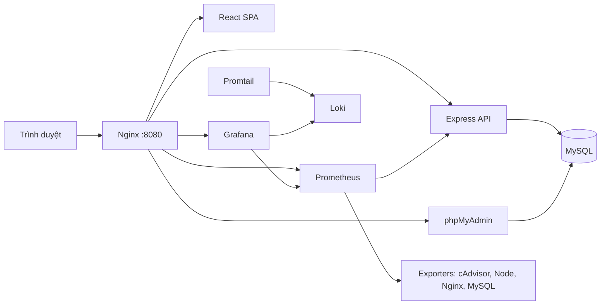

# BÁO CÁO ĐỀ TÀI THỰC HÀNH SỐ 21

## HỆ THỐNG QUẢN LÝ CỬA HÀNG VÀ BÁN HÀNG POS

**Môn học:** Triển khai và Quản trị Hệ thống Phần mềm  
**Sinh viên:** Nguyễn Anh Tuấn  
**Mã số sinh viên:** DTC245200672  
**Lớp:** CNTT K23M  
**Giảng viên hướng dẫn:** [Họ tên giảng viên]  
**Trường/Khoa:** [Tên trường và khoa]  
**Năm học:** [Năm học]

> Trước khi nộp, thay tất cả nội dung trong ngoặc vuông bằng thông tin chính xác. Báo cáo này mô tả thiết kế và cấu hình đã chuẩn bị trong repository. Những phần ghi **[BỔ SUNG ẢNH/KẾT QUẢ DEMO]** cần được hoàn thiện sau khi chạy hệ thống trên máy thực tế; không dùng ảnh minh họa giả lập làm bằng chứng.

\newpage

## LỜI MỞ ĐẦU

Các cửa hàng bán lẻ cần theo dõi danh mục hàng hóa, giá bán, số lượng tồn, giao dịch và doanh thu hằng ngày. Khi dùng bảng tính hoặc sổ ghi chép riêng lẻ, việc kiểm tra lượng hàng còn lại sau bán thường chậm; thông tin hóa đơn và số lượng hàng xuất kho có thể không đồng nhất. Một ứng dụng POS tập trung giúp nhân viên tra cứu hàng nhanh, tạo hóa đơn và lưu thay đổi tồn kho cùng với giao dịch.

Đề tài số 21 yêu cầu triển khai một website quản lý bán hàng tại cửa hàng, kết nối MySQL và phpMyAdmin, đặt Nginx làm reverse proxy, theo dõi hệ thống qua Prometheus/Grafana, tập trung log bằng Loki/Promtail và áp dụng các biện pháp hardening. Đồ án này xây dựng một ứng dụng POS cửa hàng tổng quát với các chức năng sản phẩm, điều chỉnh tồn kho, bán hàng và lịch sử hóa đơn. Hệ thống đóng gói bằng Docker Compose để các thành phần có thể khởi chạy theo một cấu hình thống nhất.

Mục tiêu của báo cáo là trình bày phạm vi chức năng, kiến trúc triển khai, mô hình dữ liệu, luồng hoạt động và cách thực hiện demo. Kết quả định lượng và ảnh chụp màn hình cần được ghi nhận sau khi chạy thật, tránh kết luận vượt quá bằng chứng thu thập được.

\newpage

## TÓM TẮT

Hệ thống POS Store gồm ứng dụng web viết bằng React và TypeScript, REST API sử dụng Node.js/Express, cơ sở dữ liệu MySQL 8.4 và giao diện quản trị dữ liệu phpMyAdmin. Nginx phục vụ giao diện tĩnh và định tuyến các đường dẫn `/api`, `/phpmyadmin`, `/grafana` và `/prometheus` đến đúng dịch vụ. Chỉ cổng Nginx được công khai trên máy chủ; MySQL và các dịch vụ nội bộ không publish cổng trực tiếp ra host.

Người dùng đăng nhập bằng tài khoản được khởi tạo trong lần chạy đầu. Ứng dụng phân biệt quản trị viên và thu ngân. Quản trị viên quản lý sản phẩm và điều chỉnh tồn kho; thu ngân tạo giỏ hàng, chọn phương thức thanh toán và lập hóa đơn. Khi hoàn tất thanh toán, API khóa các dòng sản phẩm liên quan, kiểm tra tồn kho, ghi hóa đơn và chi tiết hóa đơn, giảm tồn kho và tạo bản ghi biến động kho trong cùng một transaction MySQL.

Prometheus thu thập metrics từ API và các exporter. Grafana được cấu hình sẵn datasource Prometheus/Loki và dashboard hạ tầng. Promtail đọc Docker JSON logs rồi gửi về Loki. Các cấu hình Compose tách network theo luồng truy cập, dùng mật khẩu ngẫu nhiên, giới hạn quyền container, chạy API/Nginx bằng user không phải root, cùng các security headers ở reverse proxy.

**Từ khóa:** POS, Docker Compose, MySQL, Nginx, Prometheus, Grafana, Loki, Promtail, hardening.

\newpage

## 1. MỤC TIÊU VÀ PHẠM VI

### 1.1 Mục tiêu

Đồ án hướng đến một hệ thống có thể chạy trên máy cá nhân hoặc máy chủ Linux bằng Docker Compose. Các mục tiêu cụ thể gồm:

1. Quản lý sản phẩm bằng SKU, tên, giá, số lượng tồn và ngưỡng cảnh báo.
2. Hỗ trợ tra cứu hàng hóa, lập giỏ và tạo hóa đơn tại quầy.
3. Đảm bảo giao dịch bán hàng và cập nhật kho nhất quán trong cơ sở dữ liệu.
4. Phân quyền tối thiểu cho vai trò quản trị viên và thu ngân.
5. Cung cấp công cụ để xem dữ liệu, theo dõi metrics và truy vấn log.
6. Tách mã nguồn, cấu hình và hướng dẫn để có thể version-control trong Git.

### 1.2 Phạm vi chức năng

Phiên bản thực hành tập trung vào vòng đời cơ bản của hàng hóa: tạo sản phẩm, nhập/điều chỉnh số lượng, bán và ghi nhận lịch sử. Mỗi sản phẩm có SKU duy nhất. Hóa đơn lưu tổng tiền, phương thức thanh toán, thời gian và nhân viên tạo giao dịch. Chi tiết hóa đơn giữ lại tên, SKU và đơn giá tại thời điểm bán để dữ liệu giao dịch vẫn có ý nghĩa khi thông tin sản phẩm thay đổi.

Hệ thống chưa tích hợp cổng thanh toán thật, máy in hóa đơn, quét mã vạch, đồng bộ nhiều chi nhánh hoặc hoàn/đổi hàng. Các phương thức tiền mặt, thẻ và chuyển khoản chỉ là nhãn nghiệp vụ cho demo. Dữ liệu mẫu chỉ nhằm giúp giao diện có thể trình bày ngay sau lần khởi tạo đầu tiên.

### 1.3 Đối tượng sử dụng

- **Quản trị viên:** quản lý hàng hóa, tồn kho và tạo tài khoản nhân viên qua API quản trị.
- **Thu ngân:** tra cứu hàng hóa, lập giao dịch bán và xem hóa đơn.
- **Người vận hành:** theo dõi logs/metrics và kiểm tra trạng thái dịch vụ.

\newpage

## 2. YÊU CẦU VÀ CÔNG NGHỆ

### 2.1 Yêu cầu chức năng

Ứng dụng cần cho phép đăng nhập, xem dashboard, tìm sản phẩm theo tên/SKU, tạo và điều chỉnh sản phẩm, cập nhật tồn kho, tạo hóa đơn nhiều mặt hàng và xem lịch sử giao dịch. Backend kiểm tra payload đầu vào, quyền truy cập và lượng tồn trước khi chấp nhận bán. Các API nghiệp vụ cần JWT hợp lệ; các endpoint quản trị yêu cầu role admin.

### 2.2 Yêu cầu phi chức năng

- **Tính nhất quán:** thanh toán và giảm kho thực hiện trong một transaction.
- **Bảo mật:** hash mật khẩu, bí mật nằm trong `.env`, hạn chế mạng và quyền container.
- **Khả năng vận hành:** healthcheck, logs JSON và metrics HTTP.
- **Khả năng quan sát:** có dashboard, metrics container, web server, API, DB và log tập trung.
- **Khả năng tái triển khai:** cấu hình dịch vụ được đặt trong Docker Compose và các thư mục cấu hình có version control.

### 2.3 Lựa chọn công nghệ

Frontend sử dụng React/TypeScript để xây dựng giao diện đơn trang; Vite đóng gói các tài nguyên tĩnh. Backend là Node.js LTS và Express, nhận HTTP JSON và tách các endpoint theo miền nghiệp vụ. Zod xác thực cấu trúc dữ liệu; bcryptjs hash mật khẩu; JWT mã hóa phiên đăng nhập. MySQL 8.4 LTS được chọn đúng yêu cầu của đề số 21, còn phpMyAdmin cung cấp giao diện quản trị cơ sở dữ liệu.

Nginx làm điểm vào duy nhất. Prometheus và các exporter thu thập số liệu; Grafana trực quan hóa Prometheus và Loki. Promtail đọc log Docker và đẩy đến Loki. Docker Compose định nghĩa dịch vụ, volume và network phục vụ triển khai trên một máy.

\newpage

## 3. KIẾN TRÚC HỆ THỐNG

### 3.1 Các lớp

1. **Lớp trình bày:** trình duyệt tải React SPA từ Nginx. Người dùng thao tác ở dashboard, danh mục hàng hóa, màn hình bán hàng và lịch sử hóa đơn.
2. **Lớp ứng dụng:** Express cung cấp API đăng nhập, dashboard, sản phẩm, kho, nhân viên, hóa đơn và metrics.
3. **Lớp dữ liệu:** MySQL lưu danh tính, danh mục, sản phẩm, hóa đơn, dòng hóa đơn và biến động kho.
4. **Lớp vận hành:** Prometheus, Grafana, Loki và Promtail theo dõi trạng thái và logs.

Nginx định tuyến cùng origin để frontend không cần giữ địa chỉ API riêng. Đường dẫn `/` trả giao diện web; `/api/` chuyển đến API; `/phpmyadmin/`, `/grafana/` và `/prometheus/` chuyển đến các dịch vụ quản trị tương ứng. Nginx bổ sung các header chống MIME sniffing, clickjacking, giới hạn quyền trình duyệt và CSP cho giao diện POS.

### 3.2 Phân vùng network

Network `edge` nối Nginx với cổng host. Network `app` nối frontend proxy, API và phpMyAdmin. Network `data` nối API, MySQL, phpMyAdmin và MySQL exporter. Network `observability` nối API, Nginx, Prometheus, Grafana và Loki. Network `metrics` nối Prometheus với exporter/cAdvisor. Network nội bộ được đánh dấu `internal`; MySQL không có `ports` publish.

### 3.3 Sơ đồ



\newpage

## 4. THIẾT KẾ CƠ SỞ DỮ LIỆU

### 4.1 Các bảng chính

| Bảng | Nội dung | Ràng buộc quan trọng |
|---|---|---|
| `users` | Tài khoản, mật khẩu hash, tên hiển thị, role và trạng thái | `username` duy nhất; role admin/cashier |
| `categories` | Danh mục sản phẩm | `name` duy nhất |
| `products` | SKU, tên, danh mục, giá, tồn và ngưỡng cảnh báo | SKU duy nhất; khóa ngoại danh mục |
| `sales` | Số hóa đơn, nhân viên, tiền hàng, giảm giá, tổng tiền và phương thức | `receipt_no` duy nhất; khóa ngoại user |
| `sale_items` | Mặt hàng, số lượng, đơn giá và thành tiền của hóa đơn | Khóa ngoại hóa đơn và sản phẩm |
| `stock_movements` | Lịch sử tăng/giảm kho, lý do và tham chiếu | Khóa ngoại sản phẩm và user |

### 4.2 Quan hệ dữ liệu

Một danh mục có thể có nhiều sản phẩm; một nhân viên có thể tạo nhiều hóa đơn; một hóa đơn có nhiều dòng hàng; một sản phẩm xuất hiện trong nhiều dòng hóa đơn và nhiều biến động kho. Bảng `sale_items` lưu snapshot tên hàng và SKU để biên lai không mất nội dung lịch sử khi tên hàng trong danh mục được chỉnh sửa.

### 4.3 Tính toàn vẹn giao dịch

API checkout mở transaction, gộp số lượng các dòng trùng sản phẩm, khóa từng dòng sản phẩm bằng `SELECT ... FOR UPDATE`, xác nhận hàng còn đủ, tính tổng và tạo hóa đơn. Tiếp theo API ghi từng dòng chi tiết, trừ tồn kho và thêm stock movement. Nếu một bước phát sinh lỗi, transaction rollback để không tồn tại hóa đơn dở dang hoặc số lượng kho âm. Ràng buộc khóa ngoại bảo vệ liên kết giữa dữ liệu nghiệp vụ.

### 4.4 Khởi tạo

Khi API kết nối lần đầu, các bảng được tạo idempotent. Nếu chưa có user, API dùng `ADMIN_USERNAME` và `ADMIN_PASSWORD` từ môi trường để tạo tài khoản admin đã hash. Khi kho chưa có sản phẩm, một số mặt hàng demo được tạo để trình diễn quy trình bán.

\newpage

## 5. TRIỂN KHAI ỨNG DỤNG VÀ DATABASE

### 5.1 Chuẩn bị môi trường

Máy chạy cần Node.js 24 LTS và Docker Compose v2. Trên Windows cần Docker Desktop sử dụng Linux containers. Chạy `npm run setup` để tạo `.env`; script sinh mật khẩu ngẫu nhiên cho database, exporter, JWT, Grafana và admin. `.env` không được commit. Sau đó chạy `docker compose up --build -d` để build giao diện/API và khởi tạo dịch vụ.

### 5.2 Luồng ứng dụng

Người dùng truy cập cổng Nginx. Nginx trả file SPA và phục vụ API cùng origin. API xác thực token trước khi đọc dữ liệu nghiệp vụ; backend kết nối MySQL qua network riêng. phpMyAdmin cũng kết nối MySQL nhưng không publish cổng riêng ra host. Host chỉ truy cập các dịch vụ qua Nginx trên cổng cấu hình mặc định `8080`.

### 5.3 Dữ liệu và vận hành

MySQL dùng named volume để giữ dữ liệu sau khi container dừng. Grafana, Prometheus và Loki cũng dùng các volume độc lập. Lệnh `docker compose down` dừng các dịch vụ và giữ volume. Lệnh `docker compose down -v` xóa dữ liệu demo; chỉ thực hiện khi cần tạo lại môi trường sạch.

### 5.4 Bằng chứng cần bổ sung

**[BỔ SUNG ẢNH/KẾT QUẢ DEMO]** Chụp màn hình trang POS, danh sách sản phẩm, giao dịch vừa tạo và các bảng `sales`, `sale_items`, `stock_movements` trên phpMyAdmin. Ghi ngày giờ demo, phiên bản Docker, trạng thái từng container và lỗi thực tế nếu có. Không ghi “đã chạy thành công” trước khi quan sát kết quả.

\newpage

## 6. NGINX REVERSE PROXY VÀ BẢO MẬT

### 6.1 Reverse proxy

Nginx phục vụ static build và chuyển tiếp API đến Express. Các UI phpMyAdmin, Grafana và Prometheus được đặt sau các prefix URL để giảm số cổng công khai. Proxy truyền tiếp Host, IP client và protocol đến upstream. Chỉ dịch vụ web có khai báo `ports`; các dịch vụ khác chỉ giao tiếp trong network Compose.

### 6.2 Security headers

Nginx trả `X-Content-Type-Options: nosniff`, `X-Frame-Options: DENY`, `Referrer-Policy`, `Permissions-Policy` và Content Security Policy ở SPA. API dùng Helmet để thêm header phù hợp cho endpoint JSON. Đề cho phép security headers cơ bản thay cho HTTPS tự ký; cấu hình demo dùng HTTP local cùng các header này. Khi triển khai ngoài mạng nội bộ, cần đặt TLS terminator và chuyển sang HTTPS.

### 6.3 Hardening ứng dụng

- API chạy dưới UID/GID `10001`, Nginx dưới UID/GID `101`.
- Hai container này dùng root filesystem read-only và tmpfs cho file tạm.
- Tắt quyền Linux capabilities không cần thiết, đặt `no-new-privileges` và giới hạn PID/CPU/RAM.
- Không publish cổng MySQL; network `data` và `app` là internal.
- Mật khẩu khởi tạo được random hóa, lưu trong `.env` bị Git ignore; mật khẩu user hash bằng bcrypt.
- API kiểm tra role admin cho thay đổi sản phẩm, kho và tạo user; đăng nhập áp rate limit.
- SQL nghiệp vụ dùng placeholder parameters; payload được validate và body JSON có giới hạn kích thước.

### 6.4 Giới hạn bảo mật

Mật khẩu nằm trong file `.env` để phù hợp bài tập đơn máy. Với môi trường thực tế nên dùng secrets manager, TLS, backup mã hóa, giám sát cảnh báo và quy trình xoay vòng secret. phpMyAdmin được mở trong mạng demo để phục vụ chấm bài; không nên public Internet nếu không có lớp xác thực và giới hạn truy cập bổ sung.

\newpage

## 7. GIÁM SÁT PROMETHEUS VÀ GRAFANA

### 7.1 Metrics

API xuất `http_requests_total`, `http_request_duration_seconds` và default Node.js process metrics tại `/metrics`. Prometheus scrape mỗi 15 giây. Nginx Exporter lấy số liệu từ `stub_status`; MySQL Exporter dùng tài khoản exporter chỉ có quyền đọc metrics cần thiết. cAdvisor thu thập chỉ số container; Node Exporter thu thập chỉ số host khi chạy trên Linux.

### 7.2 Dashboard

Grafana được provision datasource Prometheus và Loki, đồng thời nạp dashboard “POS Store - Tổng quan hạ tầng”. Dashboard gồm tốc độ request, lỗi 5xx, CPU/bộ nhớ container, kết nối Nginx và trạng thái MySQL. Các biểu đồ giúp người demo quan sát thay đổi khi truy cập API hoặc tạo giao dịch.

### 7.3 Bằng chứng demo

**[BỔ SUNG ẢNH/KẾT QUẢ DEMO]** Chụp trạng thái `UP` của các target trong Prometheus và dashboard Grafana sau khi có request thực tế. Ghi lại target nào hoạt động trên môi trường hiện tại; cAdvisor/Node Exporter phụ thuộc nền tảng Docker host, do đó cần mô tả nếu chạy Windows Docker Desktop/WSL2 và exporter host không lấy đủ metrics.

### 7.4 Cách đọc

Đường request/s tăng khi API nhận traffic. Lỗi 5xx tăng có thể biểu hiện lỗi server hoặc upstream. Bộ nhớ container và CPU dùng để phát hiện tải bất thường. `mysql_up` bằng 1 biểu thị exporter kết nối được database. Dữ liệu demo không thay thế kiểm thử tải hoặc giám sát SLA.

\newpage

## 8. LOG TẬP TRUNG LOKI VÀ PROMTAIL

Promtail đọc các file Docker JSON log ở đường dẫn engine, giải mã trường log và stream rồi gửi nội dung đến Loki. Nginx xuất access/error logs ra stdout/stderr; API cũng ghi log có cấu trúc JSON. Loki giữ log trong volume cục bộ với cấu hình retention 7 ngày. Grafana dùng datasource Loki để tìm kiếm theo nhãn `job` và `stream`. Đề bài yêu cầu Promtail, tuy vậy Grafana kết thúc hỗ trợ Promtail từ 02/03/2026; cấu hình này giữ agent theo rubric, còn triển khai mới nên xem xét Grafana Alloy.

Các truy vấn dùng trong demo:

```logql
{job="docker"}
{job="docker"} |= "error"
{job="docker", stream="stderr"} | json
```

Truy vấn thứ nhất hiển thị log từ Docker containers. Truy vấn thứ hai lọc dòng có từ khóa error. Truy vấn thứ ba lọc stderr và phân tích JSON. Trong lúc demo cần tạo request thật và kiểm tra truy vấn trả về log tương ứng. Nếu Docker Desktop lưu container log bên trong VM mà bind mount `/var/lib/docker/containers` không đọc được, điều chỉnh đường dẫn bind theo runtime đang sử dụng hoặc chạy project trong môi trường Linux/WSL2.

Promtail không gắn Docker socket trong cấu hình để tránh cấp cho agent đọc log quyền điều khiển daemon. Việc đọc log phụ thuộc quyền truy cập đường dẫn container log. Nếu log driver của Docker thay đổi khỏi `json-file`, cần cập nhật cấu hình scrape.

**[BỔ SUNG ẢNH/KẾT QUẢ DEMO]** Chụp ba truy vấn LogQL, thời gian truy vấn và một số dòng log API/Nginx có nguồn gốc rõ ràng. Không đưa token, mật khẩu hoặc dữ liệu cá nhân vào ảnh chụp.

\newpage

## 9. QUY TRÌNH DEMO VÀ ĐÁNH GIÁ

### 9.1 Quy trình demo

1. Chạy script setup và khởi động stack bằng Docker Compose.
2. Mở ứng dụng, đăng nhập tài khoản admin đã được in ra trong lần tạo `.env`.
3. Xem dashboard và dữ liệu sản phẩm mẫu.
4. Tạo một SKU mới và chỉnh số lượng tồn; xác nhận thay đổi hiển thị trên danh sách.
5. Tạo hóa đơn gồm hai sản phẩm; xác nhận tổng tiền, số hóa đơn, lịch sử giao dịch và số tồn sau bán.
6. Mở phpMyAdmin để xem các bảng dữ liệu; mở Grafana để xem dashboard và các metrics.
7. Truy vấn Loki bằng ba câu LogQL ở chương 8.
8. Tạo user thu ngân qua endpoint quản trị, đăng nhập vai trò đó và xác nhận API quản trị bị từ chối.

### 9.2 Bảng đối chiếu yêu cầu

| Yêu cầu đề | Thành phần trong repository | Bằng chứng cần chụp khi chạy |
|---|---|---|
| Source, cấu hình, README và commit | Toàn bộ mã nguồn, README, nhóm mốc commit đề xuất | Trang repository và lịch sử commit |
| Website + MySQL + DB tool | React, Express, MySQL, phpMyAdmin | POS và bảng dữ liệu |
| Nginx reverse proxy | `frontend/nginx.conf`, cổng duy nhất | Truy cập ứng dụng qua Nginx |
| Prometheus/Grafana | `observability/prometheus`, provisioning Grafana | Targets UP và dashboard |
| Loki/Promtail, 2–3 LogQL | Cấu hình Loki, Promtail và ví dụ LogQL | Kết quả Explore |
| Hardening | Docker Compose, Dockerfile, `.env` | Cấu hình user, network và header |
| Demo tổng thể | README và quy trình chương này | Ảnh/biên bản demo có ngày giờ |

### 9.3 Nhận xét kết quả

Phần nhận xét cuối cần hoàn thành sau khi demo: ghi dịch vụ khởi động được, endpoint nào đạt health, giao dịch nào được tạo, số tồn trước/sau, metrics/log nào quan sát được và vấn đề còn tồn tại. Không tự đặt số liệu hiệu năng hay khẳng định kiểm thử khi chưa có kết quả thu thập.

\newpage

## 10. KẾT LUẬN VÀ HƯỚNG PHÁT TRIỂN

Đồ án đặt nền tảng POS cho cửa hàng quy mô nhỏ, thực hiện chu trình cơ bản từ quản lý sản phẩm đến lập hóa đơn và giảm tồn kho. Cấu hình Docker Compose triển khai đồng bộ ứng dụng và các dịch vụ vận hành, đồng thời tách network nhằm giới hạn đường truy cập. Nginx làm reverse proxy và áp dụng security headers. Prometheus/Grafana cung cấp giám sát; Loki/Promtail hỗ trợ tra cứu log tập trung.

Các điểm cần hoàn thiện trước khi nộp gồm chạy demo trên máy thật, chụp ảnh minh chứng, điền danh tính sinh viên, tạo repository GitHub theo MSSV và tạo ba commit có nội dung rõ ràng. Môi trường Docker Desktop trên Windows có thể cần điều chỉnh bind mount log/host metrics so với Linux thuần.

Hướng phát triển tiếp theo gồm phân trang và lọc hóa đơn, xuất hóa đơn PDF, tìm kiếm mã vạch, quản lý nhiều chi nhánh, hoàn/đổi hàng, backup tự động, cảnh báo tồn thấp qua email, audit log và triển khai HTTPS bằng chứng thư được quản lý. Các tính năng mới cần giữ nguyên tính nguyên tử của giao dịch và kiểm soát quyền theo vai trò.

\newpage

## TÀI LIỆU THAM KHẢO

1. Đề tài thực hành môn Triển khai và Quản trị Hệ thống Phần mềm, mục đề số 21 và yêu cầu triển khai chung.
2. Tài liệu chính thức Node.js Releases, trạng thái LTS: <https://nodejs.org/en/about/previous-releases>.
3. Tài liệu React: <https://react.dev/learn>.
4. Tài liệu Express: <https://expressjs.com/>.
5. MySQL 8.4 Reference Manual, MySQL Releases: <https://dev.mysql.com/doc/refman/8.4/en/mysql-releases.html>.
6. Tài liệu Docker Compose: <https://docs.docker.com/compose/>.
7. Tài liệu Prometheus: <https://prometheus.io/docs/introduction/overview/>.
8. Tài liệu Grafana Loki và LogQL: <https://grafana.com/docs/loki/latest/>.

## PHỤ LỤC: THÔNG TIN TRIỂN KHAI

| Mục | Giá trị ghi nhận |
|---|---|
| Ngày và giờ demo | [Bổ sung] |
| Hệ điều hành / Docker Engine | [Bổ sung] |
| Commit hash 1 / 2 / 3 | [Bổ sung] |
| Kết quả Docker Compose | [Bổ sung] |
| Kết quả giao dịch mẫu | [Bổ sung mã hóa đơn, số tiền, tồn kho trước/sau] |
| Kết quả dashboard và LogQL | [Bổ sung] |
| Hạn chế môi trường phát hiện được | [Bổ sung] |
