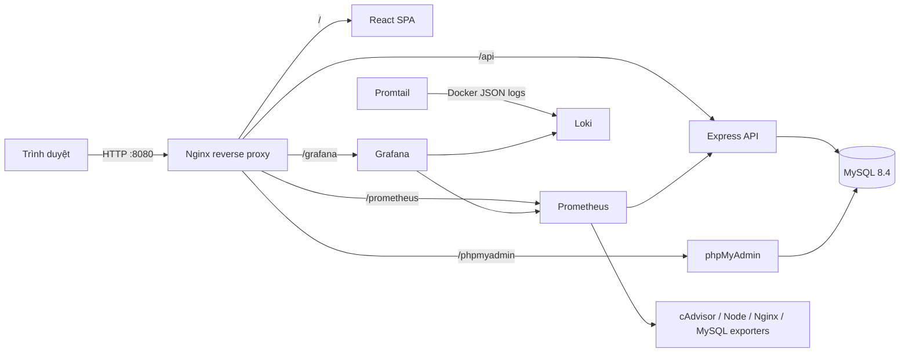

# POS Store - Đề tài thực hành số 21

Ứng dụng quản lý bán hàng cửa hàng gồm danh mục sản phẩm, tồn kho, quầy bán hàng, hóa đơn và báo cáo doanh thu. Hệ thống triển khai bằng Docker Compose với MySQL 8.4 và phpMyAdmin, Nginx reverse proxy, Prometheus/Grafana và Loki/Promtail.

## Công nghệ

- Frontend: React 19, TypeScript, Vite.
- API: Node.js 24 LTS, Express 5, JWT, bcrypt và Zod.
- Cơ sở dữ liệu: MySQL 8.4 LTS; phpMyAdmin để quản trị.
- Reverse proxy: Nginx, chỉ công khai một cổng HTTP; bật các security headers.
- Giám sát: Prometheus, Grafana, cAdvisor, Node Exporter, Nginx Exporter và MySQL Exporter.
- Log tập trung: Loki + Promtail đọc Docker JSON logs.
- Đóng gói: Docker Compose với network phân lớp và volume dữ liệu riêng.

## Khởi chạy

Yêu cầu Node.js 24 LTS và Docker Desktop/Engine có Docker Compose v2. Trên Windows, bật Linux containers trong Docker Desktop.

```powershell
npm run setup
docker compose up --build -d
docker compose ps
```

Lệnh setup tạo `.env` với mật khẩu ngẫu nhiên và in thông tin tài khoản quản trị ban đầu. Giữ riêng file `.env`; không đưa file này lên GitHub. Dữ liệu cửa hàng mẫu được tạo khi MySQL khởi tạo lần đầu.

Nếu Docker Compose báo lỗi thiếu tài nguyên, hãy cấp ít nhất 4 GB RAM cho Docker Desktop. Lần chạy đầu tải các image và cài dependencies trong quá trình build, vì vậy sẽ mất lâu hơn những lần sau.

## Địa chỉ dịch vụ

| Dịch vụ | Địa chỉ | Ghi chú |
|---|---|---|
| Ứng dụng POS | `http://localhost:8080/` | Cổng duy nhất mở ra máy host |
| phpMyAdmin | `http://localhost:8080/phpmyadmin/` | Đăng nhập bằng `MYSQL_USER` và `MYSQL_PASSWORD` trong `.env` |
| Grafana | `http://localhost:8080/grafana/` | Tài khoản trong `GRAFANA_ADMIN_USER` / `GRAFANA_ADMIN_PASSWORD` |
| Prometheus | `http://localhost:8080/prometheus/` | UI được proxy qua Nginx |
| API | `http://localhost:8080/api/v1/` | API JSON; tài liệu endpoints bên dưới |

## Chức năng

- Đăng nhập bằng tài khoản quản trị khởi tạo từ `.env`; phiên JWT hết hạn sau 8 giờ.
- Quản trị viên tạo sản phẩm, đặt ngưỡng cảnh báo tồn và điều chỉnh số lượng nhập/xuất.
- Thu ngân tra cứu sản phẩm, tạo giỏ, chọn phương thức thanh toán và lập hóa đơn.
- Thanh toán khóa dòng sản phẩm trong MySQL, kiểm tra tồn kho, tạo hóa đơn, cập nhật kho và ghi biến động kho trong một transaction.
- Trang tổng quan hiển thị doanh thu trong ngày, số hóa đơn, lượng hàng và cảnh báo sắp hết.
- Sản phẩm mẫu: cà phê, trà, bánh quy, bình giữ nhiệt và túi vải. Đây là dữ liệu minh họa có thể thay bằng mặt hàng của cửa hàng.

Tài khoản nhân viên được tạo qua API `POST /api/v1/users` với quyền quản trị. Ví dụ:

```powershell
$token = "<JWT lấy từ POST /api/v1/auth/login>"
$body = @{ username = "thungan01"; password = "MatKhauManh-2026"; name = "Thu ngân 01"; role = "cashier" } | ConvertTo-Json
Invoke-RestMethod -Method Post -Uri http://localhost:8080/api/v1/users -Headers @{ Authorization = "Bearer $token" } -ContentType "application/json" -Body $body
```

API đọc sản phẩm: `GET /api/v1/products`; thêm sản phẩm: `POST /api/v1/products`; điều chỉnh kho: `POST /api/v1/inventory/adjust`; tạo đơn: `POST /api/v1/checkout`; danh sách hóa đơn: `GET /api/v1/orders`. Các API nghiệp vụ cần `Authorization: Bearer <JWT>`.

## Mô hình triển khai



Mạng `edge` nhận kết nối từ host. Mạng `app` nối Nginx, API và phpMyAdmin; `data` chỉ nối API, MySQL, phpMyAdmin và exporter; `observability` nối Nginx, API, Prometheus, Grafana và Loki; `metrics` chỉ dành cho exporter. MySQL không publish cổng ra host. Các database và dữ liệu giám sát lưu ở named volumes.

## Giám sát

Prometheus đọc metrics ứng dụng ở `api:3000/metrics`, đồng thời scrape Nginx Exporter, MySQL Exporter, cAdvisor và Node Exporter. Dashboard `POS Store - Tổng quan hạ tầng` được provision tự động vào Grafana.

## LogQL để demo

Trong Grafana mở **Explore → Loki** và chạy một số truy vấn:

```logql
{job="docker"}
{job="docker"} |= "error"
{job="docker", stream="stderr"} | json
```

Loki dùng volume lưu log cục bộ. Bản demo giữ dữ liệu log trong 7 ngày; đây là cấu hình cho bài thực hành trên một máy, không phải thiết kế lưu trữ HA.

**Lưu ý vòng đời:** đề thực hành yêu cầu Promtail, nhưng Grafana đã kết thúc hỗ trợ Promtail từ ngày 02/03/2026. Repository giữ Promtail để khớp rubric của đề; khi áp dụng cho hệ thống mới ngoài bài tập, nên chuyển cấu hình scrape sang Grafana Alloy.

## Hardening đã áp dụng

- API chạy user không phải root `10001`; Nginx chạy user không phải root `101`.
- Container API và Nginx dùng root filesystem chỉ đọc, tmpfs cho file tạm, `no-new-privileges`, `cap_drop: ALL` và giới hạn PID/tài nguyên.
- MySQL không mở port host; các network được phân đoạn và `internal` khi không cần ra ngoài.
- Tạo JWT, mật khẩu database, exporter, Grafana và tài khoản quản trị ngẫu nhiên bằng `npm run setup`; `.env` bị Git ignore.
- Hash mật khẩu bằng bcrypt; API yêu cầu đăng nhập và kiểm tra quyền admin cho thao tác quản trị; đăng nhập bị rate-limit.
- Nginx thêm `X-Content-Type-Options`, `X-Frame-Options`, CSP, Referrer-Policy và Permissions-Policy.
- API dùng câu lệnh SQL tham số hóa, kiểm tra payload bằng Zod và transaction cho thanh toán.

Đề cho phép Nginx dùng HTTPS tự ký **hoặc** security headers cơ bản. Cấu hình mặc định dùng HTTP cùng security headers để chạy ngay trên máy cá nhân. Nếu cần HTTPS trong demo, có thể bổ sung chứng thư tự ký hoặc terminator TLS ở phía trước.

## Bài demo gợi ý

1. Mở POS, đăng nhập bằng tài khoản được in ở bước setup.
2. Xem tổng quan; xác nhận dữ liệu mẫu và hàng sắp chạm ngưỡng.
3. Thêm sản phẩm, điều chỉnh kho, rồi tạo hóa đơn với 2 mặt hàng.
4. Mở lịch sử hóa đơn và phpMyAdmin để xem bảng `products`, `sales`, `sale_items`, `stock_movements`.
5. Mở Grafana và dashboard; kiểm tra metric HTTP, CPU/bộ nhớ container, Nginx và MySQL.
6. Mở Grafana Explore, chọn Loki và chạy ít nhất ba truy vấn LogQL ở trên.
7. Tạo tài khoản cashier qua API, đăng nhập lại bằng cashier và trình bày giới hạn quyền quản trị.

## Quản lý Git theo yêu cầu đề

Ba mốc commit nên được tạo theo các nhóm sau:

1. `feat: POS app, MySQL, phpMyAdmin and Nginx reverse proxy`
2. `feat: Prometheus and Grafana monitoring`
3. `feat: Loki, Promtail, hardening and project report`

Sau khi hoàn thiện, tạo repository GitHub theo mã số sinh viên, thêm remote và push các commit. Tên repository/mã số sinh viên chưa được tự điền để tránh dùng nhầm danh tính.

## Báo cáo

Mở [BAO_CAO_DE_21.md](BAO_CAO_DE_21.md). Báo cáo có các phần kiến trúc, mô hình dữ liệu, quy trình triển khai, hardening, dashboard và truy vấn log. Trước khi nộp, điền thông tin sinh viên, tạo ảnh chụp màn hình từ hệ thống đã chạy và ghi nhận kết quả demo thực tế vào các vị trí đánh dấu.

## Lệnh vận hành

```powershell
docker compose logs -f api
docker compose logs -f promtail loki
docker compose down
```

`docker compose down -v` xóa cả database và dữ liệu giám sát; chỉ dùng khi muốn tạo lại demo từ đầu.
